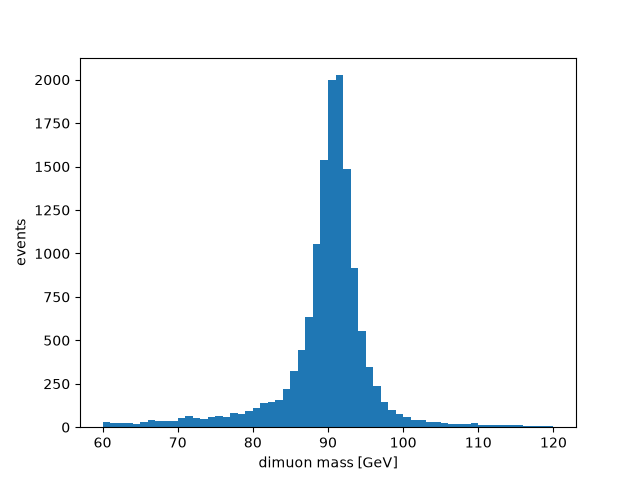
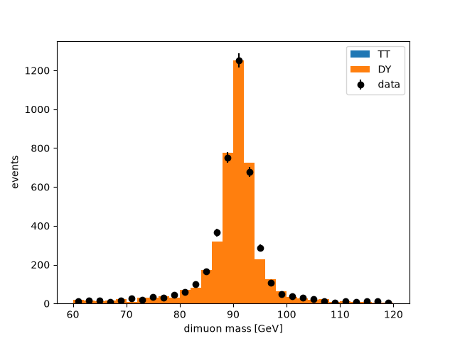

# Step by step "rowver-vication"

This file walks you through making plots and embedding `.rvr` files into your analysis framework. To learn why `.rvr` exists and how it speeds up an analysis, [read the introduction](../INTRO.md).

## 1. Before you start

`rvr` is meant to run on your own laptop, reading ROOT files straight from where they are stored:
on your computer, or on grid storage over HTTPS. This guide reads CMS Open Data, which anyone can
read with no grid certificate or proxy, so all you need is `rvr` and the Python package. Your own
files on grid storage need a grid proxy (step 10). Another idea is to press (create) the `.rvr`
file on a remote machine close to the files (like CMS LPC), and copy it to your laptop.

If you don't have `rvr` yet, set it up once by following [the setup page](../SETUP.md):

1. [Install rvr and rowver](../SETUP.md#1-install-rvr-and-rowver)
2. For your own files on grid storage only: [install your grid certificate](../SETUP.md#2-install-your-grid-certificate-on-your-laptop),
   [make a grid proxy](../SETUP.md#3-make-a-grid-proxy) and [check it](../SETUP.md#4-check-it).

### What you write

You write two short text files, and `rvr` does the rest:

| file | what it says | written by |
|---|---|---|
| `samples.toml` | which events to read: the files of each sample | you |
| `recipe.toml` | which events to keep, and what to store of each | you |
| `samples.lock` | every file the samples are, pinned (size, checksum, entries, branches) | `rvr samples resolve` |
| `zmumu.rvr` | the events, with the three texts above inside it | `rvr press` |

The study here is Z → μμ in CMS Open Data of 2012: Drell-Yan simulation first, then data and tt̄
beside it. Its files, as they are at step 7, are in [`zmumu`](zmumu).

### The example studies

Each folder here is a whole study: a `samples.toml` and a `recipe.toml`. Copy one, then run
`rvr samples resolve samples.toml` and `rvr press` in it. A test (`crates/rvr/tests/examples.rs`)
checks that every one still reads, and with `-- --ignored` presses each one again
(`rvr press --events 2000`). The outputs this page quotes come from
[`walkthrough.sh`](walkthrough.sh), which runs every command of it again. None needs a grid proxy.

| study | what it shows |
|---|---|
| [`atlas_higgs_4lep`](atlas_higgs_4lep) | ATLAS Open Data: H → ZZ* → 4ℓ, four leptons of zero total charge, two or four of each flavour, their mass, a weight the files carry every factor of, and the four-lepton system's pt as a derived column |
| [`dimuon_spectrum`](dimuon_spectrum) | the dimuon mass spectrum of CMS Open Data: two muons of opposite charge, and their mass |
| [`higgs_tautau`](higgs_tautau) | every sample of the CMS Open Data H → ττ study: the data from two files by a pattern, signals and backgrounds, a muon and a tau of opposite charge |
| [`lhcb_b_to_kkk`](lhcb_b_to_kkk) | LHCb Open Data: B± → K± K+ K− from three tracks' flat branches, the B mass from defined names, the two magnet polarities written as eras |
| [`recipe_tour`](recipe_tour) | every table of a recipe: defined names that use one another, jets cleaned of muons and taus, a trigger named by each sample, a cut for one sample only, a renamed branch, a stored type; events chosen at random |
| [`zmumu`](zmumu) | this page's study: data, Drell-Yan and tt̄, the sum of weights over every event read, and a weight per event worked out from it |

## 2. Make your first file

Make a folder, `zmumu`, with two files in it.

`samples.toml` names one sample: the Drell-Yan simulation of CMS Open Data, read over HTTPS from
CERN's public EOS, the tree to read (`Events`), and how many events to read: the first 100,000,
for a quick start (leave `events` out to read them all).

```toml
format = "rvr-samples"
version = 1

[places]
opendata = "root://eospublic.cern.ch//eos/opendata/cms/derived-data/AOD2NanoAODOutreachTool"

[defaults]
tree = "Events"
events = 100_000

[eras]

[[sample]]
name = "DY"
label = "Drell-Yan"
files = "{opendata}/DYJetsToLL.root"
metadata = { kind = "simulation", xsec = 3503.7, lumi = 11.6 }
```

Its first two lines name the file's form and its version. `[places]` gives a short name to a long
location, used as `{opendata}` in `files`; `[defaults]` holds what every sample shares; `[eras]`
makes one sample per era, and is empty here. All three are written even when empty, so the file
says at a glance what it uses. `metadata` is what the file carries about the sample (here its
cross section in pb and the luminosity in fb⁻¹), which the recipe reads as `sample.xsec`. Every key
is one [the specification](../SPEC.md#3-samplestoml) defines: a key it does not know, such as a
misspelt `evnets`, is refused, naming the nearest one.

`recipe.toml` says what to keep. Its first two lines name the recipe language and its version, so
a later rvr knows how to read it. The rest is explained below it.

```toml
format = "rvr-recipe"
version = 1

[define]
good_muon = "Muon_pt > 20 and abs(Muon_eta) < 2.4"

[keep]
two_muons = "count(good_muon) == 2"
opposite_charge = "sum(Muon_charge[good_muon]) == 0"

[columns]
branches = ["nMuon"]
mass = "first(pair_mass(Muon_pt[good_muon], Muon_eta[good_muon], Muon_phi[good_muon], Muon_mass[good_muon]), -1)"
pt = "first(pair_pt(Muon_pt[good_muon], Muon_eta[good_muon], Muon_phi[good_muon], Muon_mass[good_muon]), -1)"

[totals]

[derived]
```

**Reading the recipe.** Every value in quotes is an expression over the event's branches, each
named in full, as the file spells it.

- `[define]` gives names to expressions, for the lines below to use. `good_muon` is true or false
  for each muon of each event: true for the muons with pt above 20 GeV and |η| below 2.4. An event
  with three muons, two of which pass, has two good muons. Nothing under `[define]` is stored.
- `[keep]` chooses the events. Each line is a cut: a name you choose (`two_muons`) and a condition
  that is true or false for each event. `count(good_muon)` counts the good muons, so an event
  passes the first cut when it has exactly two, and the second when their charges add up to zero.
  An event is kept when every cut is true, and `rvr press` prints how many pass each one.
- `[columns]` says what the file stores. `branches` are stored as the ROOT file has them, for the
  events kept. `mass` is computed for each event kept: `Muon_pt[good_muon]` is the good muons'
  pt (the brackets keep the members where `good_muon` is true), `pair_mass` the mass of each pair
  of them, and `first(…, -1)` the first pair's mass, or -1 for an event with no pair. `pt` is the
  pair's transverse momentum, alike.
- `[totals]` and `[derived]` are empty for now (later steps fill them). Every recipe writes its
  five tables, even the empty ones: `rvr press` refuses a recipe that leaves one out, or, at a
  terminal, offers to write it in.

**How do you know the file has `Muon_pt`?** You don't have to guess. Once the samples are resolved
(just below), `rvr branches` lists every branch of the sample's first file, from the lock, and
`--find` narrows them down:

```text
$ rvr branches --find muon
DY: DYJetsToLL.root, tree Events, 16 of its 69 branches hold "muon"

  Muon_charge          i4  jagged
  Muon_dxy             f4  jagged
  Muon_dxyErr          f4  jagged
  Muon_dz              f4  jagged
  Muon_dzErr           f4  jagged
  Muon_eta             f4  jagged
  Muon_genPartIdx      i4  jagged
  Muon_jetIdx          i4  jagged
  Muon_mass            f4  jagged
  Muon_pfRelIso03_all  f4  jagged
  Muon_pfRelIso04_all  f4  jagged
  Muon_phi             f4  jagged
  Muon_pt              f4  jagged
  Muon_softId          b1  jagged
  Muon_tightId         b1  jagged
  nMuon                u4  flat
```

Each branch says its type and whether it is `flat` (one value per event) or `jagged` (a list per
event). Run `rvr branches` with no `--find` for all of them. A name the file doesn't have is caught
too:

```text
$ rvr try "count(Muon_ptt > 20)"
rvr try: DYJetsToLL.root, entries 0 to 9: There is no column named Muon_ptt. Did you mean: Muon_pt, Muon_eta, Muon_phi? rvr branches lists every branch the file has.
```

Only what `[columns]` names is stored. `good_muon` is a working name: to store the good muons' pt,
add a column, `good_muon_pt = "Muon_pt[good_muon]"`.

Every word you can use in a recipe (`count`, `first`, `pair_mass` and the rest) is listed in the
[recipe reference](../../crates/rvr-recipe/README.md), each with an example and what it gives. If you
know Awkward, its [last section](../../crates/rvr-recipe/README.md#from-python-to-rvr) puts common
selections side by side with how you write them in a recipe. To try an expression on real events
before you press, use [`rvr try`](#trying-an-expression).

In the folder, `rvr samples resolve` finds every file of every sample (it reads no events), checks
the recipe against what it found as a press would, and writes `samples.lock` (none when the recipe
does not fit). `rvr press` reads the events and writes `zmumu.rvr`, named after the folder.
`rvr validate` checks it.

```text
$ rvr samples resolve samples.toml
  ok    DY                                         1 file      9.2 GB   100,000 of 30,458,871 events

1 sample, 1 distinct file, 9.2 GB in 2.0 s.
The folders read also hold 9 .root files no sample reads (not an error; check none was meant):
  root://eospublic.cern.ch//eos/opendata/cms/derived-data/AOD2NanoAODOutreachTool/GluGluToHToTauTau.root
  root://eospublic.cern.ch//eos/opendata/cms/derived-data/AOD2NanoAODOutreachTool/Run2012BC_DoubleMuParked_Muons.root
  root://eospublic.cern.ch//eos/opendata/cms/derived-data/AOD2NanoAODOutreachTool/Run2012B_TauPlusX.root
  … and 6 more
Wrote samples.lock (0.0 MB).
$ rvr press
Pressing 1 sample, 1 file, 100,000 entries, 1 at a time:
  1/1      100,000 entries     14,483 kept   DYJetsToLL.root
Read 100,000 entries; kept after each cut:
  two_muons                             14,562
  opposite_charge                       14,483
Wrote zmumu.rvr (14,483 rows, 3 columns, 0.1 MB) in 2.6 s.
$ rvr validate zmumu.rvr
zmumu.rvr: valid, 14483 rows, 3 columns, read 100,000 of 30,458,871 entries, not signed
```

rvr read only the branches the recipe uses, and only the first 100,000 events of the file's 30
million. Before it reads a file, it checks that the file is the one the lock pinned.

### Trying an expression

While you work out a cut or a column, `rvr try` shows what an expression gives on the first events
of the study's first sample, without pressing anything. It needs `samples.lock` (so resolve
first), opens one file and reads only the branches the expression names, so it takes seconds:

```text
$ rvr try "count(good_muon)"
DY: DYJetsToLL.root, tree Events (i8, one value per event)
  entry        0   0
  entry        1   1
  entry        2   1
  entry        3   0
  entry        4   1
  entry        5   0
  entry        6   0
  entry        7   1
  entry        8   0
  entry        9   2
```

The recipe's defined names work in it, `--events N` shows N events, and `--kept` shows only the
events the `[keep]` cuts keep. Those are the rows the press writes: the entries and masses here
are the first ones `zmumu.rvr` holds (step 3 shows them).

```text
$ rvr try "Muon_pt[good_muon]" --kept --events 5
DY: DYJetsToLL.root, tree Events (f4, a list per event)
  entry        9   [44.30339, 43.80025]
  entry       13   [30.331768, 52.109802]
  entry       16   [35.363716, 43.758724]
  entry       17   [46.6518, 41.99093]
  entry       21   [23.655155, 22.02532]
$ rvr try "first(pair_mass(Muon_pt[good_muon], Muon_eta[good_muon], Muon_phi[good_muon], Muon_mass[good_muon]), -1)" --kept --events 5
DY: DYJetsToLL.root, tree Events (f4, one value per event)
  entry        9   90.361694
  entry       13   90.838066
  entry       16   85.008064
  entry       17   90.80479
  entry       21   50.598198
```

## 3. Look inside it

`rvr dump --columns` shows every column, its type, and its first values:

```text
$ rvr dump zmumu.rvr --columns
sample         i4[14483]  [0, 0, 0, 0, 0, ...]
entry          i8[14483]  [9, 13, 16, 17, 21, ...]
nMuon          u4[14483]  [2, 2, 2, 2, 2, ...]
mass           f4[14483]  [90.361694, 90.838066, 85.008064, 90.80479, 50.598198, ...]
pt             f4[14483]  [7.516675, 23.074041, 38.344116, 4.6697426, 3.2600317, ...]
kind           text by sample[1]  DY: "simulation"
xsec           f8 by sample[1]  DY: 3503.7
lumi           f8 by sample[1]  DY: 11.6
events_read    i8 by sample[1]  DY: 100000
events_total   i8 by sample[1]  DY: 30458871
```

`sample` and `entry` say where each event came from: its sample, and its entry in its file.
`kind`, `xsec` and `lumi` (the sample's metadata) and `events_read` and `events_total` hold one
value per sample. `rvr dump` alone shows everything, the three texts included, and
`rvr dump --all` every value of every column.

## 4. Plot it

Python reads it with the package `rowver` (`pip install rowver`). Each column is a NumPy array, one
value per event:

```python
import matplotlib.pyplot as plt
import rowver

f = rowver.open("zmumu.rvr")
plt.hist(f["mass"], bins=60, range=(60, 120))
plt.xlabel("dimuon mass [GeV]")
plt.ylabel("events")
plt.savefig("mass.png")
```



With ROOT, from Python, the same arrays fill a TH1 and a TH2 (`FillN` takes the values and a
weight for each; ROOT wants `float64`). This needs a Python that has both ROOT and `rowver`:

```python
import numpy as np
import ROOT
import rowver

f = rowver.open("zmumu.rvr")
mass = f["mass"].astype(np.float64)
pt = f["pt"].astype(np.float64)
ones = np.ones(len(mass))

h = ROOT.TH1D("mass", ";m_{#mu#mu} [GeV];events", 60, 60, 120)
h.FillN(len(mass), mass, ones)

h2 = ROOT.TH2D("mass_pt", ";m_{#mu#mu} [GeV];p_{T}^{#mu#mu} [GeV]", 30, 60, 120, 25, 0, 100)
h2.FillN(len(mass), mass, pt, ones)

c = ROOT.TCanvas("c", "", 1200, 500)
c.Divide(2)
c.cd(1)
h.Draw()
c.cd(2)
ROOT.gPad.SetRightMargin(0.15)
h2.SetStats(0)
h2.Draw("colz")
c.SaveAs("mass_root.png")
```

Both work the same in a Jupyter notebook; show the plot with `plt.show()` or `c.Draw()`.

## 5. Add a column you forgot

Say you want each muon's pT too. Add `"Muon_pt"` to `branches` in `recipe.toml`. `rvr status` says
whether the file is current and what a press would do, and `rvr press` then reads only the new
column, for the events the file already has:

```text
$ rvr status
zmumu.rvr: pressed 2026-11-03T20:16:48Z by rvr 15.0.0
  recipe.toml   changed since: new: Muon_pt
  samples.toml  as the file holds it
  samples.lock  as the file holds it
  events        as the file holds it
rvr press would read only Muon_pt, for the events the file kept, and copy every other column from it.

  DY  ████████████████████████ 100%   1 file
$ rvr press
zmumu.rvr has the events this recipe keeps (14,483) and 3 of its 4 columns.
Reading only Muon_pt for those events, 1 file, 1 at a time:
  1/1      100,000 entries     14,483 kept   DYJetsToLL.root
Wrote zmumu.rvr (14,483 rows, 4 columns, 0.3 MB) in 2.0 s.
```

`Muon_pt` holds a list per event (every muon), which Python reads as an Awkward array. The file
now holds the study as it is, so pressing again does nothing and leaves the file as it is (and
`rvr status` exits 0):

```text
$ rvr press
zmumu.rvr is current: nothing to press.
```

A column computed only from what the file already stores needs no ROOT file at all, and no room in
the file either: put it under `[derived]`, as `leading_muon_pt = "first(Muon_pt, -1)"`. The file
keeps the expression, and the Python package works it out when you ask for
`f["leading_muon_pt"]`. `rvr press` then opens no input:

```text
$ rvr press
zmumu.rvr has the events this recipe keeps (14,483) and 4 of its 4 columns.
Nothing to read: every column is copied from it.
Wrote zmumu.rvr (14,483 rows, 4 columns and 1 derived, 0.3 MB) in 0.0 s.
```

`rvr derive zmumu.rvr 'NAME = EXPRESSION'` adds one to the file alone
([Derived columns](../../crates/rvr/README.md#derived-columns)).

## 6. Add data and another background

Now put the 2012 data and tt̄ beside the Drell-Yan. `[defaults]` gives every sample the same tree,
number of events and metadata; a sample's own `metadata` adds to it, key by key. The data file of
this Open Data release holds only the muons (their momenta and charges), which is why the recipe
uses nothing else: every branch a recipe reads must be in every sample's files.

```toml
format = "rvr-samples"
version = 1

[places]
opendata = "root://eospublic.cern.ch//eos/opendata/cms/derived-data/AOD2NanoAODOutreachTool"

[defaults]
tree = "Events"
events = 100_000
metadata = { kind = "simulation", lumi = 11.6 }   # fb⁻¹: Run 2012 B and C

[eras]

[[sample]]
name = "data"
label = "Data, Run 2012 B and C"
files = "{opendata}/Run2012BC_DoubleMuParked_Muons.root"
metadata = { kind = "data" }

[[sample]]
name = "DY"
label = "Drell-Yan"
files = "{opendata}/DYJetsToLL.root"
metadata = { xsec = 3503.7 }                       # pb

[[sample]]
name = "TT"
label = "tt̄"
files = "{opendata}/TTbar.root"
metadata = { xsec = 225.2 }
```

`DY` is the sample it was (the same file, tree, events and metadata, now partly from
`[defaults]`), and the recipe is the same, so after resolving again `rvr press` reads only the new
samples and takes DY's rows from the file:

```text
$ rvr samples resolve samples.toml
  ok    data                                       1 file      2.2 GB   100,000 of 61,540,413 events
  ok    DY                                         1 file      9.2 GB   100,000 of 30,458,871 events
  ok    TT                                         1 file      3.5 GB   100,000 of 6,423,106 events

3 samples, 3 distinct files, 15.0 GB in 1.8 s.
The folders read also hold 7 .root files no sample reads (not an error; check none was meant):
  root://eospublic.cern.ch//eos/opendata/cms/derived-data/AOD2NanoAODOutreachTool/GluGluToHToTauTau.root
  root://eospublic.cern.ch//eos/opendata/cms/derived-data/AOD2NanoAODOutreachTool/Run2012B_TauPlusX.root
  root://eospublic.cern.ch//eos/opendata/cms/derived-data/AOD2NanoAODOutreachTool/Run2012C_TauPlusX.root
  … and 4 more
Wrote samples.lock (0.0 MB).
$ rvr status
zmumu.rvr: pressed 2026-11-03T20:17:06Z by rvr 15.0.0
  recipe.toml   as the file holds it
  samples.toml  edited since
  samples.lock  resolved again since
  events        as the file holds it
rvr press would read only the new samples data, TT (2 files), and copy the rows of every other sample from it.

  DY  ████████████████████████ 100%   1 file
$ rvr press
zmumu.rvr holds the rows of 1 of the 3 samples as samples.lock has them.
Reading only the new samples data, TT, 2 files, 200,000 entries, 2 at a time:
  1/2      100,000 entries      1,746 kept   TTbar.root
  2/2      100,000 entries     10,420 kept   Run2012BC_DoubleMuParked_Muons.root
Read 200,000 entries of the new samples data, TT; kept after each cut:
  two_muons                             14,740
  opposite_charge                       12,166
Wrote zmumu.rvr (26,649 rows, 4 columns and 1 derived, 0.5 MB) in 3.1 s.
$ rvr dump zmumu.rvr --columns
sample          i4[26649]  [0, 0, 0, 0, 0, ...]
entry           i8[26649]  [6, 33, 36, 38, 57, ...]
nMuon           u4[26649]  [2, 2, 2, 2, 2, ...]
Muon_pt         jagged f4[26649]  [[57.6067, 53.04508], [45.61478, 32.98454], [42.350727, 29.168762], ...]
mass            f4[26649]  [113.64686, 88.297104, 88.33483, 91.27149, 93.55725, ...]
pt              f4[26649]  [4.690069, 13.55605, 16.843533, 27.262497, 4.780898, ...]
leading_muon_pt f4[26649]  derived = "first(Muon_pt, -1)"  [57.6067, 45.61478, 42.350727, 40.19343, 38.26939, ...]
kind            text by sample[3]  data: "data", DY: "simulation", TT: "simulation"
lumi            f8 by sample[3]  data: 11.6, DY: 11.6, TT: 11.6
events_read     i8 by sample[3]  data: 100000, DY: 100000, TT: 100000
events_total    i8 by sample[3]  data: 61540413, DY: 30458871, TT: 6423106
xsec            f8 by sample[3]  data: null, DY: 3503.7, TT: 225.2
```

The samples are in the order `samples.toml` gives them: `sample` is 0 for data, 1 for DY, 2 for
TT. The data have no `xsec`, which is `null` for them.

## 7. Data against simulation

A simulated sample's events are weighted by its cross section times the luminosity, divided by the
sum of the weights of every event it read, before the cuts. The file keeps only the events that
passed them, so the recipe asks the press for that sum as it reads, under `[totals]` (one number
per sample), and a derived column divides by it. Every simulated event of these files weighs 1, so
the sum of the weights is the number of events read, and the total is `"1"`; for NanoAOD with
generator weights it is `sumw = "genWeight"`.

```toml
# Every simulated event of these files weighs 1, so the sum of the weights is the number read.
[totals]
sumw = "1"

# Worked out from what the file holds when it is read.
[derived]
leading_muon_pt = "first(Muon_pt, -1)"
weight = "if(sample.kind == 'data', 1.0, sample.xsec * 1000 * sample.lumi / sample.sumw)"
```

A total counts every event read, so changing `[totals]` presses every event again:

```text
$ rvr press
Pressing every column: zmumu.rvr cannot be built on, as the totals under [totals] have changed, which count every event read.
Pressing 3 samples, 3 files, 300,000 entries, 3 at a time:
  1/3      100,000 entries     14,483 kept   DYJetsToLL.root
  2/3      100,000 entries      1,746 kept   TTbar.root
  3/3      100,000 entries     10,420 kept   Run2012BC_DoubleMuParked_Muons.root
Read 300,000 entries; kept after each cut:
  two_muons                             29,302
  opposite_charge                       26,649
Wrote zmumu.rvr (26,649 rows, 4 columns and 2 derived, 0.5 MB) in 7.0 s.
$ rvr dump zmumu.rvr --columns
…
weight          f8[26649]  derived = "if(sample.kind == 'data', 1.0, sample.xsec * 1000 * sample.lumi / sample.sumw)"  [1, 1, 1, 1, 1, ...]
…
sumw            f8 by sample[3]  data: 100000.0, DY: 100000.0, TT: 100000.0
…
```

Each total is the sum, in the files' order, over the 100,000 events each sample read. Then the
data against the stacked simulation, with the simulation scaled to the share of the data that was
read (100,000 of its 61.5 million events):

```python
import matplotlib.pyplot as plt
import numpy as np
import rowver

f = rowver.open("zmumu.rvr")

# Only part of the data was read: scale the simulation to the same share of its luminosity.
read, total = f.sample_columns["events_read"], f.sample_columns["events_total"]
share = read[0] / total[0]

bins = np.linspace(60, 120, 31)
mass, weight, sample = f["mass"], f["weight"], f["sample"]
counts, _ = np.histogram(mass[sample == 0], bins)
plt.errorbar((bins[1:] + bins[:-1]) / 2, counts, yerr=np.sqrt(counts), fmt="ko", label="data")
plt.hist([mass[sample == 2], mass[sample == 1]], bins, stacked=True, label=["tt̄", "Drell-Yan"],
         weights=[weight[sample == 2] * share, weight[sample == 1] * share])
plt.xlabel("dimuon mass [GeV]")
plt.ylabel("events")
plt.legend()
plt.savefig("stack.png")
```



`f.to_pandas()`, `f.to_parquet("zmumu.parquet")` and `f.arrays()` (Awkward) give the same columns
in other forms; the [Python README](../../crates/rowver-py/README.md) lists them.

## 8. Read more events

The first 100,000 events were for a start. `rvr samples plan` says what a press would read, from
the lock alone, before you commit to it: every event, or a number chosen at random from every file
(the first events of a sample are those of its first files, which can be a biased few).

```text
$ rvr samples plan samples.lock --events all
What a press would read (--events all: every sample whole), planned from the lock in 0.0 ms:
  data                                                  all 61,540,413 events   1 of 1 files
  DY                                                    all 30,458,871 events   1 of 1 files
  TT                                                     all 6,423,106 events   1 of 1 files
98,422,390 of 98,422,390 events in all.
$ rvr samples plan samples.lock --events 50000 --random --seed 7
What a press would read (--events 50000 --random --seed 7), planned from the lock in 51.7 ms:
  data                                     50,000 of 61,540,413 events (random)   1 of 1 files
  DY                                       50,000 of 30,458,871 events (random)   1 of 1 files
  TT                                       50,000 of 6,423,106 events (random)   1 of 1 files
150,000 of 98,422,390 events in all.
```

`rvr press --events all` (or `--events 50000 --random --seed 7`) then presses that. To make it
the study's own choice, set `events` (and `choose = "random"`, `seed = 7`) in `samples.toml`
instead. A large press is best run close to the files, on the LPC or lxplus (step 10).

## 9. Share it, check it, sign it

Commit `samples.toml`, `recipe.toml` and `samples.lock`, and send the `.rvr` to whoever needs it.
It carries all three texts, so `rvr reproduce` makes it again from the file alone and compares:

```text
$ rvr reproduce zmumu.rvr
Wrote zmumu.reproduced/ with the recipe.toml, samples.toml and samples.lock zmumu.rvr holds.
Pressing 3 samples, 3 files, 300,000 entries, 3 at a time:
  1/3      100,000 entries     14,483 kept   DYJetsToLL.root
  2/3      100,000 entries      1,746 kept   TTbar.root
  3/3      100,000 entries     10,420 kept   Run2012BC_DoubleMuParked_Muons.root
Read 300,000 entries; kept after each cut:
  two_muons                             29,302
  opposite_charge                       26,649
Wrote zmumu.reproduced/zmumu.rvr (26,649 rows, 4 columns and 2 derived, 0.5 MB) in 4.2 s.
Comparing the two with rvr diff:
The headers show no difference in rows, samples, labels, columns, derived columns, by_sample or sample columns.
```

`rvr key new` makes a signing key once; every file you press after that is signed, and
`rvr validate` says who signed it (others trust your key with the `rvr key trust` line it prints).
The key goes in `~/.config/rvr` (or the folder `RVR_CONFIG` names); the path below has your home
folder shortened to `~`.

```text
$ rvr key new "A. Physicist"
Made your key ~/.config/rvr/key (keep it private). Every file you press is signed with it from now on.
Your public key, for whoever reads your files:
  a916435b5d41b65072cf70beeb506da0bc9f68842d74f7458dd273fad2eaac46
They trust your files with:
  rvr key trust a916435b5d41b65072cf70beeb506da0bc9f68842d74f7458dd273fad2eaac46 A. Physicist
$ rvr press --full
Pressing 3 samples, 3 files, 300,000 entries, 3 at a time:
  1/3      100,000 entries     14,483 kept   DYJetsToLL.root
  2/3      100,000 entries      1,746 kept   TTbar.root
  3/3      100,000 entries     10,420 kept   Run2012BC_DoubleMuParked_Muons.root
Read 300,000 entries; kept after each cut:
  two_muons                             29,302
  opposite_charge                       26,649
Signed with your key a916435b5d41b650…
Wrote zmumu.rvr (26,649 rows, 4 columns and 2 derived, 0.5 MB) in 3.6 s.
$ rvr validate zmumu.rvr
zmumu.rvr: valid, 26649 rows, 4 columns, 2 derived, read 300,000 of 98,422,390 entries, signed by you
```

## 10. Your own ntuples, and pressing on the LPC

The same study works for your own files. A file on your computer is named by its path
(`files = "~/data/DY.root"`, or relative to the folder of `samples.toml`), with no proxy needed.
A file on grid storage is named by its `root://` path (or a `davs://` or `https://` URL), with `*`
and `?` in the file name to match several; rvr reads it over HTTPS from the storage's door, which
needs your grid proxy (`rvr proxy init`, [setup](../SETUP.md#3-make-a-grid-proxy)). The path below
is made up, to show the form; put the folder of your own ntuples there.

```toml
[places]
lpc = "root://cmseos.fnal.gov//store/user/YOUR_USERNAME/MADE_UP_FOLDER"   # a made-up path

[[sample]]
name = "DY"
files = "{lpc}/DYJetsToLL_*.root"
tree = "Events"
```

`rvr samples check samples.lock` asks whether the files have changed since the lock was written.

On the LPC or lxplus, the Linux download runs as it is (no CMSSW). Press where the press survives
your logout, on a disk with room for the press's spool as well as the file it writes:

```sh
mkdir -p ~/bin && cd ~/bin
curl -sL https://gitlab.cern.ch/api/v4/projects/dgrove%2Frowver/packages/generic/rvr/15.0.0/rvr-15.0.0-x86_64-linux.tar.gz | tar xz
~/bin/rvr proxy init                 # reads ~/.globus there, as on a laptop
cd ~/nobackup/zmumu                  # the study folder, copied there
tmux new -s press                    # detach with Ctrl-b d; come back with tmux attach -t press
~/bin/rvr press --events all
```

## 11. When something goes wrong

Every error says what went wrong and what to do. A flag rvr does not know is wrong use: the command
does nothing, names the nearest flag, prints its usage, and exits 2.

```text
$ rvr press --event 1000
rvr press: --event is not one of its flags. Did you mean: --events?
usage:
  rvr press [DIR] [--events N|all] [--random] [--seed S] [--out FILE] [--workers N] [--full]
            [--fill [KINDS]] [--restart]
…
```

Everything a press is given is checked before it reads an event: a misspelt branch names the
nearest ones (here `mass` was written with `Muon_ptt[good_muon]`), and nothing is read.

```text
$ rvr press
rvr press: [columns] mass: There is no column named Muon_ptt. Did you mean: Muon_pt, Muon_eta, Muon_phi? (samples data, DY, TT, over the branches samples.lock lists for each)
```

A value in the data that the recipe cannot take stops the press, naming the file, the entry, the
column and the value. Here a column was to hold the leading muon's pt in tenths of a GeV, in one
byte (`pt_tenths = { value = "first(Muon_pt[good_muon], 0) * 10", stored = "u1" }`), which holds 0
to 255 only:

```text
$ rvr press
zmumu.rvr has the events this recipe keeps (26,649) and 4 of its 5 columns.
Reading only pt_tenths for those events, 3 files, 3 at a time:
rvr press: root://eospublic.cern.ch//eos/opendata/cms/derived-data/AOD2NanoAODOutreachTool/Run2012BC_DoubleMuParked_Muons.root, tree Events, entry 6: [columns] pt_tenths: 576.0670166015625 does not fit in u1, which holds 0 to 255. The recipe cannot take this value: mend the recipe (or the file), then press again. zmumu.rvr was not written.
```

A storage that is busy is waited for (each wait printed), and the press carries on where it was.

A file that cannot be read (gone, changed since the lock, damaged, or at a storage that kept
failing or refuses it) does not stop the press: the file is written without its events, records
the **hole** with why, and the press exits with status 3. (Building on an earlier file to add a
column, it does stop; `rvr press --full` makes holes of it.) `rvr status` shows what each sample is
missing, and `rvr press --fill` reads only the holes once they can be read. Here a study of local
files (90 copies of one skim, in three samples) lost one file, which was then put back:

```text
$ rvr press
Pressing 3 samples, 90 files, 636,390 entries, 10 at a time:
…
  36/90            0 entries          0 kept   f45.root
    hole (gone): files/f45.root no longer exists: put it back and run rvr press --fill (if it moved, run rvr samples resolve samples.toml again, then rvr press).
…
Read 629,319 of 636,390 entries; kept after each cut:
  met                                  313,547
  leptons                              313,547
Signed with your key a916435b5d41b650…
Wrote three.rvr (313,547 rows, 7 columns, 0.8 MB) in 0.5 s, with 1 hole:
  gone        late_and_long_named_sample  files/f45.root no longer exists: put it back and run rvr press --fill (if it moved, run rvr samples resolve samples.toml again, then rvr press).
rvr press --fill reads them again once they can be read.
$ rvr status
three.rvr: pressed 2026-11-03T20:17:30Z by rvr 15.0.0
  recipe.toml   as the file holds it
  samples.toml  as the file holds it
  samples.lock  as the file holds it
  events        as the file holds it
It holds the study as it is, but for its holes: rvr press --fill reads them.

  early                       ████████████████████████ 100%   9 files
  middle                      ████████████████████████ 100%   30 files
  late_and_long_named_sample  ███████████████████████░  98%   51 files, 1 hole

Holes, by why:
  gone         1 file, 7,071 entries   late_and_long_named_sample
      files/f45.root no longer exists: put it back and run rvr press --fill (if it moved, run rvr samples resolve samples.toml again, then rvr press).
(rvr status --holes lists every hole.)
rvr press --fill would read 7,071 entries of 1 file.
$ rvr press --fill
Filling three.rvr: reading 1 hole of 1 file, 7,071 entries, 1 at a time; every other row is the file's own:
  1/1        7,071 entries      3,523 kept   f45.root
Read 7,071 entries in the holes; kept after each cut:
  met                                    3,523
  leptons                                3,523
Signed with your key a916435b5d41b650…
Wrote three.rvr (317,070 rows, 7 columns, 0.8 MB) in 0.1 s.
$ rvr validate three.rvr --complete
three.rvr: valid, 317070 rows, 7 columns, read all 636,390 entries, signed by you
```

The filled file is the one a press of all 90 files writes. A press that stops part way (Ctrl-C, a
laptop asleep, the network gone, a disk not mounted) keeps what it read beside its file (in
`three.rvr.partial/` for `three.rvr`), and the next `rvr press` carries on from there;
`rvr status` says how far it got ([Stopped part way](../../crates/rvr/README.md#stopped-part-way)).

The [rvr README](../../crates/rvr/README.md) describes every command, the
[specification](../SPEC.md) every rule of `samples.toml` and of a press, and the
[recipe reference](../../crates/rvr-recipe/README.md) everything a recipe can say.
