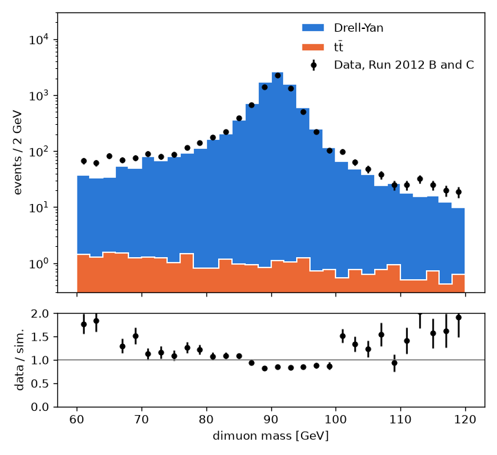
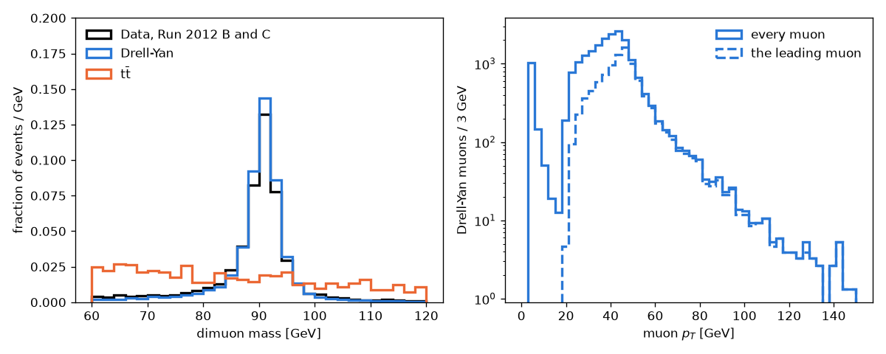
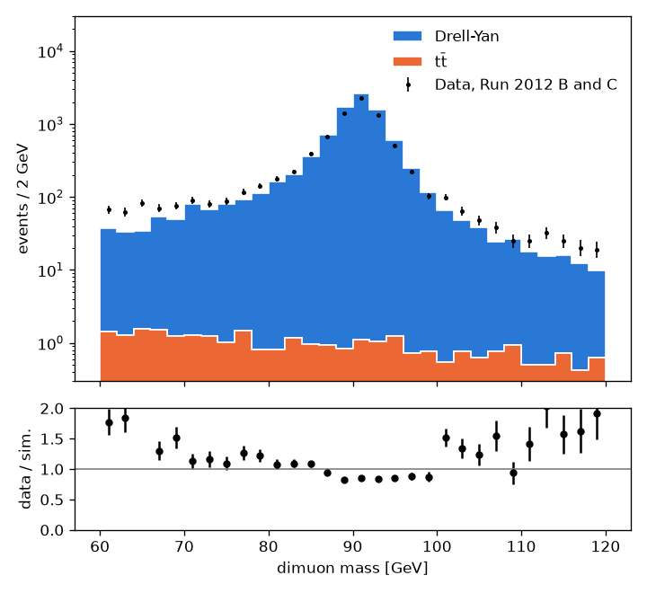
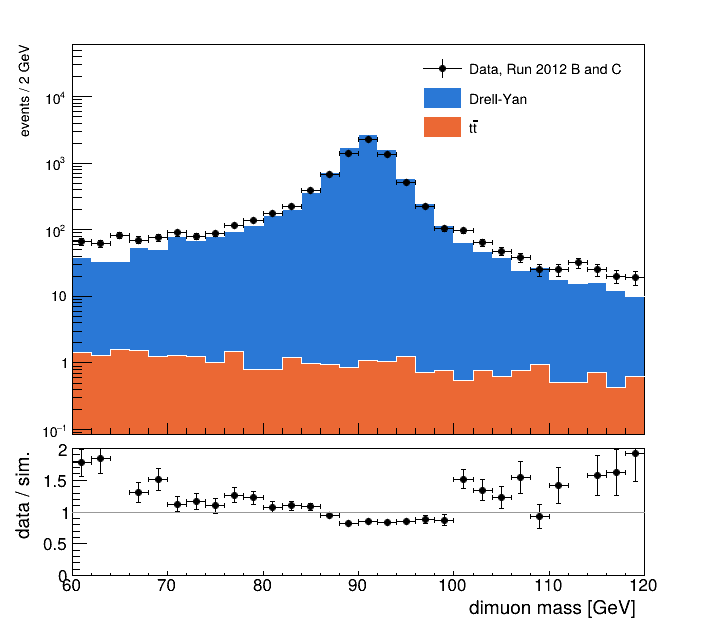

# Using a `.rvr` file in Python

Four scripts that open a `.rvr` file and hand its columns to the tools you already use. Each runs
from start to end, a `# %%` cell at a time in VS Code or Jupyter (with jupytext), or whole:

| script | what it shows | needs, besides `rowver` |
|---|---|---|
| [`columns.py`](columns.py) | working with the columns: NumPy and Awkward arrays, one sample's rows, cuts, weights, pandas | awkward, pandas, pyarrow |
| [`matplotlib_hists.py`](matplotlib_hists.py) | histograms with matplotlib: data against stacked simulation, shapes, a list column, 2D | awkward, matplotlib |
| [`hist_hists.py`](hist_hists.py) | histograms with [hist](https://hist.readthedocs.io): a category axis for the samples, yields, plots with mplhep, a ROOT file written with uproot | awkward, hist, mplhep, uproot |
| [`root_hists.py`](root_hists.py) | histograms with ROOT: TH1D, TH2D and THStack filled from the columns, an RDataFrame, a TTree | awkward, ROOT |

## The file they read

They read the file of [the guide's study](../zmumu): Z → μμ in CMS Open Data, the data beside
Drell-Yan and tt̄ simulation, with the pair's mass and pT, every muon's pT (a list per event), and a
derived weight per event. Making it takes a few seconds and needs no grid proxy:

```text
$ pip install "rowver[all]" matplotlib hist mplhep uproot    # rowver brings rvr
$ git clone https://gitlab.cern.ch/dgrove/rowver.git
$ cp -r rowver/docs/examples/zmumu . && cd zmumu
$ rvr samples resolve samples.toml
$ rvr press
…
Wrote zmumu.rvr (26,649 rows, 4 columns and 2 derived, 0.5 MB) in 2.8 s.
$ python ../rowver/docs/examples/python/columns.py
```

Each reads `zmumu.rvr` in the folder it runs in, or the file named as its argument, and writes what
it makes there (plots, and the files of the last steps). Run a cell at a time in an editor whose
folder is the study's, or give `path` the file's full path in the first cell. For a file of your
own, change the names in the script to its own.

## What to know

```python
import rowver

f = rowver.open("zmumu.rvr")
f["mass"]                    # a flat column: a NumPy array, one value per event
f["Muon_pt"]                 # a list column: an Awkward array, a list per event
f["mass"][f.rows_of("DY")]   # one sample's events: rows_of gives a slice, a view, not a copy
f.labels                     # each sample's label, for a legend
f.sample_columns["xsec"]     # one value per sample, in the order of f.samples
```

- The arrays are read-only, as a column asked for again is the same array while anything holds
  it: `.copy()` one to change it.
- A column is read when it is asked for, and `f` keeps none in memory itself: memory is what your
  own variables hold. `f.read(names, sample="TT")` (and `f.arrays`, `f.to_pandas`) reads one
  sample's rows alone.
- `f["sample"]` is each event's sample, an index into `f.samples`; a sample's rows come together,
  in the order of `f.samples`, so `f.rows_of(name)` is one slice of every column.
- A list column becomes one value per object with `ak.flatten`; its event's weight goes with each
  with `ak.broadcast_arrays(weight, column)[0]`, flattened the same way.
- ROOT's `FillN` takes `float64` arrays: `f["mass"].astype(np.float64)`. `ROOT.RDF.FromNumpy` takes
  the flat columns as they are.
- hist cannot name an axis `sample` (its `fill` takes `sample=` for something else): name it
  `process`, or anything else.

## What they draw

Data against the stacked simulation, with matplotlib (`matplotlib_hists.py`):



Each sample's shape, and a list column: every muon's pT, and the leading muon's (a derived column,
`greatest(Muon_pt, -1)`):



The same with hist and mplhep (`hist_hists.py`), each sample filled into one histogram through a
category axis:



And with ROOT (`root_hists.py`), a THStack of TH1Ds filled with `FillN`:



`columns.py`, `hist_hists.py` and `root_hists.py` each print the same yields between 80 and 100
GeV: 7,321 events of data, and 8,358.4 of Drell-Yan and 9.6 of tt̄ expected, with 100,000 events
read of each sample.
