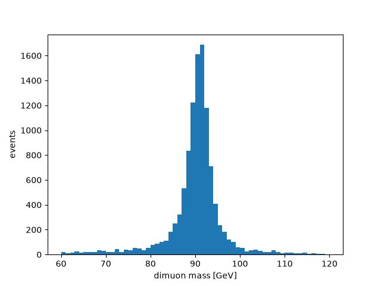
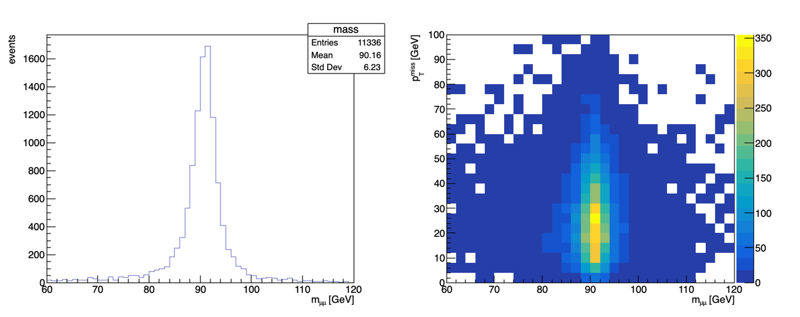
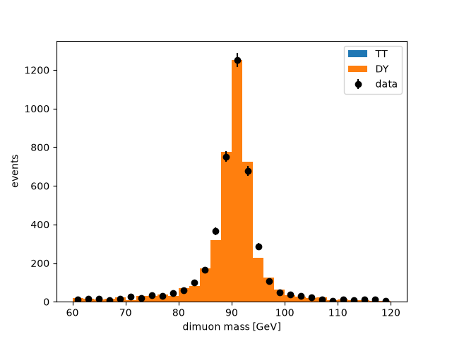

# Step by step "rowver-vication" 

This file walks you through making plots and embedding `.rvr` files into your analysis framework. To learn why `.rvr` exists and how it speeds up an analysis, [read the introduction](../intro/README.md).


## 0. Before you start

`rvr` is meant to run on your own laptop, reading CMS datasets straight from grid storage. Another idea is to press (create) the `.rvr` file(s) on a remote machine (like CMS LPC) and then copy it to your local machine. Why you might want to do that is by getting the code closer to the `.root` files, the `.rvr` file could be created faster than loading files over then network, but this is not always the case. 

If you don't have `rvr` or your grid proxy installed, set it
up once by following the instructions in [the setup section](../setup/README.md):

1. [Install rvr and rowver](../setup/README.md#1-install-rvr-and-rowver)
2. [Put your grid certificate on your laptop](../setup/README.md#2-put-your-grid-certificate-on-your-laptop)
3. [Make a grid proxy](../setup/README.md#3-make-a-grid-proxy)
4. [Check it](../setup/README.md#4-check-it): you are ready when `rvr proxy` says the proxy is valid.

## What you write

You write two short text files, and `rvr` does the rest:

| file | what it says | written by |
|---|---|---|
| `samples.toml` | which events to read: datasets, folders or files | you |
| `recipe.toml` | which events to keep, and what to store of each | you |
| `samples.lock` | every file the samples are, pinned (size, checksum, entries) | `rvr samples resolve` |
| `zmumu.rvr` | the events, with the three texts above inside it | `rvr press` |

The study here is Z → μμ: Drell-Yan simulation first, then data and tt̄ beside it.

## 2. Make your first file

Make a folder, `zmumu`, with two files in it.

`samples.toml` names one sample: a Drell-Yan dataset, exactly as DAS writes it, the tree to read
(`Events` in NanoAOD), and how many events to read: the first 100,000, for a quick start (leave
`events` out to read them all).

```toml
[[sample]]
name = "DY"
dataset = "/DYJetsToLL_M-50_TuneCP5_13TeV-amcatnloFXFX-pythia8/RunIISummer20UL18NanoAODv9-106X_upgrade2018_realistic_v16_L1v1-v2/NANOAODSIM"
tree = "Events"
events = 100_000
```

`recipe.toml` says what to keep. Its first two lines name the recipe language and its version, so
a later rvr knows how to read it. The rest is explained below it.

```toml
format = "rvr-recipe"
version = 1

[object.good_muon]
from = "Muon"
where = "pt > 20 and abs(eta) < 2.4 and tightId and pfRelIso04_all < 0.15"

[keep]
two_muons = "count(good_muon) == 2"

[copy]
branches = ["MET_pt", "nJet"]

[column]
mass = "first(pair_mass(good_muon.pt, good_muon.eta, good_muon.phi, good_muon.mass), -1)"
```

**Reading the recipe.** Two of its words come from SQL, the language of database queries, where
`SELECT … FROM muons WHERE pt > 20` picks the rows of a table that pass a condition. A recipe uses
`from` and `where` the same way, on the particles inside each event:

- `[object.good_muon]` makes a new collection, `good_muon`, out of one the file has.
  - `from = "Muon"` names the collection to start from: the muons, which are the branches named
    `Muon_…` (`Muon_pt`, `Muon_eta`, `Muon_tightId`, …).
  - `where = "…"` says which of them to keep. Inside it a bare name is the muon's own branch:
    `pt` is `Muon_pt`, `tightId` is `Muon_tightId`. A muon is a good muon when the whole condition
    is true for it.

  So in each event, `good_muon` is the muons with pt above 20 GeV, |η| below 2.4, the tight ID and
  an isolation below 0.15. An event with three muons, two of which pass, has two good muons.
  `where` never removes an event: it chooses muons within each one. After it, `good_muon.pt` is
  their pt and `count(good_muon)` how many there are. The same choice can be written inside an
  expression: `count(Muon where pt > 20)` counts the muons above 20 GeV.
- `[keep]` chooses the events. Each line is a cut: a name you choose (`two_muons`) and a condition
  that is true or false for each event. An event is kept when every cut is true, and `rvr press`
  prints how many pass each one.
- `[copy]` stores branches as the ROOT file has them, for the events kept.
- `[column]` stores a value computed for each event kept: here the mass of its two good muons
  (`first(…, -1)` takes the first pair's mass, or -1 for an event with no pair).

**How do you know the file has a `Muon` collection?** You don't have to guess. Once the samples
are resolved (just below), `rvr branches` lists every collection and branch of the sample's file,
and `--find` narrows the 1,628 branches of a NanoAOD file down (long groups are cut with `…`):

```text
$ rvr branches --find muon
Rucio said where the 1 dataset file can be read in 3.6 s.
DY: 13D0AD97-6B32-CB4C-BA87-5E37BA4CF20E.root, tree Events, 108 of its 1,628 branches hold "muon"

Jet:
  Jet_muonIdx1         int32  jagged
  Jet_muonIdx2         int32  jagged
  Jet_muonSubtrFactor  float  jagged
  Jet_nMuons           int32  jagged

Muon:
  nMuon                  uint32  flat
  Muon_charge            int32   jagged
  Muon_cleanmask         uint8   jagged
  Muon_dxy               float   jagged
  Muon_dxybs             float   jagged
  …

Flag:
  Flag_BadPFMuonDzFilter        bool  flat
  Flag_BadPFMuonFilter          bool  flat
  Flag_BadPFMuonSummer16Filter  bool  flat
  Flag_muonBadTrackFilter       bool  flat

HLT:
  HLT_Dimuon0_Jpsi                            bool  flat
  HLT_Dimuon0_Jpsi3p5_Muon2                   bool  flat
  HLT_Dimuon0_Jpsi_L1_4R_0er1p5R              bool  flat
  HLT_Dimuon0_Jpsi_L1_NoOS                    bool  flat
  HLT_Dimuon0_Jpsi_NoVertexing                bool  flat
  …

L1PreFiringWeight:
  L1PreFiringWeight_Muon_Nom     float  flat
  L1PreFiringWeight_Muon_StatDn  float  flat
  L1PreFiringWeight_Muon_StatUp  float  flat
  L1PreFiringWeight_Muon_SystDn  float  flat
  L1PreFiringWeight_Muon_SystUp  float  flat

Other:
  CorrT1METJet_muonSubtrFactor  float  jagged
  FatJet_muonIdx3SJ             int32  jagged
  FsrPhoton_muonIdx             int32  jagged
```

Each branch says its type and whether it is `flat` (one value per event) or `jagged` (a list per
event). The jagged branches under `Muon:` make the collection you use in `from = "Muon"`, `nMuon`
says how many muons each event has, and every other branch under it is an attribute you can write
inside its `where` without the prefix: `Muon_pt` is `pt`, `Muon_tightId` is `tightId`. Run `rvr branches` with no `--find` for all of them. A name the file doesn't have is caught too: `count(Jets)` says "There is no column named
Jets. Did you mean: Jet, nJet, Jet_pt?".

Only what `[copy]` and `[column]` name is stored. `good_muon` is a working name: to store the good
muons' pt, add a column, `good_muon_pt = "good_muon.pt"`.

Every word you can use in a recipe (`count`, `first`, `pair_mass` and the rest) is listed in the
[recipe reference](../crates/rvr-recipe/README.md), each with an example and what it gives. If you
know Awkward, its [last section](../crates/rvr-recipe/README.md#from-python-to-rvr) puts common
selections side by side with how you write them in a recipe. To try an expression on real events
before you press, use [`rvr try`](#trying-an-expression).

In the folder, `rvr samples resolve` finds every file of the dataset (it reads no events) and
writes `samples.lock`. `rvr press` reads the events and writes `zmumu.rvr`, named after the folder.
`rvr validate` checks it.

```text
$ rvr samples resolve samples.toml
  ok    DY                                       204 files   257.3 GB   100,000 of 195,510,810 events

1 sample, 204 distinct files, 257.3 GB in 3.8 s.
Wrote samples.lock (0.2 MB).
$ rvr press
Rucio said where the 2 dataset files can be read in 1.4 s.
Pressing 1 sample, 2 files, 100,000 entries, 2 at a time:
  1/2       59,081 entries      6,638 kept   13D0AD97-6B32-CB4C-BA87-5E37BA4CF20E.root
  2/2       40,919 entries      4,698 kept   00C9792D-ACD2-2547-BB04-097F0C4E47E3.root
  read from T2_CN_Beijing: 1 file, 1.3 MB
  read from T3_KR_KISTI: 1 file, 1.0 MB
  passed over T2_CN_Beijing (cceos.ihep.ac.cn:9000) 1 time: remote source error: … peer closed connection …
Read 100,000 entries; kept after each cut:
  two_muons                             11,336
Wrote zmumu.rvr (11,336 rows, 3 columns, 0.3 MB) in 10.5 s.
$ rvr validate zmumu.rvr
zmumu.rvr: valid, 11336 rows, 3 columns, read 100000 of 195510810 entries, not signed
```

The first 100,000 events lie in two of the 204 files. rvr read only the branches the recipe uses,
2.3 MB, from whichever storage answered first; a read that failed at one storage was tried at
another.

### Trying an expression

While you work out a cut or a column, `rvr try` shows what an expression gives on the first events
of the study's first sample, without pressing anything. It needs `samples.lock` (so resolve
first), opens one file and reads only the branches the expression names, so it takes seconds:

```text
$ rvr try "count(good_muon)"
Rucio said where the 1 dataset file can be read in 1.6 s.
DY: 13D0AD97-6B32-CB4C-BA87-5E37BA4CF20E.root, tree Events (i8, one value per event)
  entry        0   0
  entry        1   0
  entry        2   1
  entry        3   0
  entry        4   1
  entry        5   0
  entry        6   0
  entry        7   0
  entry        8   1
  entry        9   1
```

The recipe's objects and helpers work in it, `--events N` shows N events, and `--kept` shows only
the events the `[keep]` cuts keep. Those are the rows the press writes: the entries and masses here
are the first ones `zmumu.rvr` holds (step 3 shows them).

```text
$ rvr try "good_muon.pt" --kept --events 5
Rucio said where the 1 dataset file can be read in 1.3 s.
DY: 13D0AD97-6B32-CB4C-BA87-5E37BA4CF20E.root, tree Events (f4, a list per event)
  entry       14   [29.942936, 21.988777]
  entry       25   [46.90944, 46.79786]
  entry       35   [49.50759, 40.395164]
  entry       43   [47.15005, 43.033558]
  entry       52   [51.090717, 42.2735]
$ rvr try "first(pair_mass(good_muon.pt, good_muon.eta, good_muon.phi, good_muon.mass), -1)" --kept --events 5
Rucio said where the 1 dataset file can be read in 3.2 s.
DY: 13D0AD97-6B32-CB4C-BA87-5E37BA4CF20E.root, tree Events (f4, one value per event)
  entry       14   88.6032
  entry       25   93.59802
  entry       35   90.682175
  entry       43   90.26609
  entry       52   92.6495
```

## 3. Look inside it

`rvr dump --columns` shows every column, its type, and its first values:

```text
$ rvr dump zmumu.rvr --columns
sample         i4[11336]  [0, 0, 0, 0, 0, ...]
entry          i8[11336]  [14, 25, 35, 43, 52, ...]
MET_pt         f4[11336]  [21.15589, 8.36861, 7.9500065, 56.645744, 7.6471, ...]
nJet           u4[11336]  [3, 3, 2, 6, 7, ...]
mass           f4[11336]  [88.6032, 93.59802, 90.682175, 90.26609, 92.6495, ...]
events_read    i8 by sample[1]  DY: 100000
events_total   i8 by sample[1]  DY: 195510810
```

`sample` and `entry` say where each event came from: its sample, and its entry in its file.
`events_read` and `events_total` hold one value per sample. `rvr dump` alone shows everything,
the three texts included.

## 4. Plot it

Python reads it with the package `rowver` (`pip install ./crates/rowver-py` from a checkout of this
repository). Each column is a NumPy array, one value per event:

```python
import matplotlib.pyplot as plt
import rowver

f = rowver.open("zmumu.rvr")
plt.hist(f["mass"], bins=60, range=(60, 120))
plt.xlabel("dimuon mass [GeV]")
plt.ylabel("events")
plt.savefig("mass.png")
```



With ROOT, from Python, the same arrays fill a TH1 and a TH2 (`FillN` takes the values and a
weight for each; ROOT wants `float64`). This needs a Python that has both ROOT and `rowver`:

```python
import numpy as np
import ROOT
import rowver

f = rowver.open("zmumu.rvr")
mass = f["mass"].astype(np.float64)
met = f["MET_pt"].astype(np.float64)
ones = np.ones(len(mass))

h = ROOT.TH1D("mass", ";m_{#mu#mu} [GeV];events", 60, 60, 120)
h.FillN(len(mass), mass, ones)

h2 = ROOT.TH2D("mass_met", ";m_{#mu#mu} [GeV];p_{T}^{miss} [GeV]", 30, 60, 120, 25, 0, 100)
h2.FillN(len(mass), mass, met, ones)

c = ROOT.TCanvas("c", "", 1200, 500)
c.Divide(2)
c.cd(1)
h.Draw()
c.cd(2)
ROOT.gPad.SetRightMargin(0.15)
h2.SetStats(0)
h2.Draw("colz")
c.SaveAs("mass_root.png")
```



Both work the same in a Jupyter notebook; show the plot with `plt.show()` or `c.Draw()`.

## 5. Add a column you forgot

Say you want each muon's pT too. Add `"Muon_pt"` to `branches` in `recipe.toml`. `rvr status` says
whether the file is current and what a press would do, and `rvr press` then reads only the new
column, for the events the file already has:

```text
$ rvr status
zmumu.rvr: pressed 2026-10-29T19:47:31Z by rvr 14.3.0
  recipe.toml   changed since: new: Muon_pt
  samples.toml  as the file holds it
  samples.lock  as the file holds it
  events        as the file holds it
rvr press would read only Muon_pt, for the events the file kept, and copy every other column from it.
$ rvr press
Rucio said where the 2 dataset files can be read in 1.3 s.
zmumu.rvr has the events this recipe keeps (11,336) and 3 of its 4 columns.
Reading only Muon_pt for those events, 2 files 2 at a time:
  1/2       40,919 entries      4,698 kept   00C9792D-ACD2-2547-BB04-097F0C4E47E3.root
  2/2       59,081 entries      6,638 kept   13D0AD97-6B32-CB4C-BA87-5E37BA4CF20E.root
  read from T2_CN_Beijing: 2 files, 0.7 MB
Wrote zmumu.rvr (11,336 rows, 4 columns, 0.4 MB) in 4.6 s.
$ rvr status
zmumu.rvr: pressed 2026-10-29T19:47:38Z by rvr 14.3.0
  recipe.toml   as the file holds it
  samples.toml  as the file holds it
  samples.lock  as the file holds it
  events        as the file holds it
It is current: rvr press has nothing to read.
```

`Muon_pt` holds a list per event (every muon), which Python reads as an Awkward array.

## 6. Add data and another background

Now put 2018D data and tt̄ beside the Drell-Yan. `[defaults]` gives every sample the same tree and
number of events. Any other key, such as `kind`, `xsec` or `lumi`, is information about the
sample: it is stored in the file, and the recipe can use it as `sample.kind`.

```toml
[defaults]
tree = "Events"
events = 100_000
lumi = 31.84                  # fb⁻¹ of 2018D

[[sample]]
name = "data"
dataset = "/SingleMuon/Run2018D-UL2018_MiniAODv2_NanoAODv9-v1/NANOAOD"
kind = "data"

[[sample]]
name = "DY"
dataset = "/DYJetsToLL_M-50_TuneCP5_13TeV-amcatnloFXFX-pythia8/RunIISummer20UL18NanoAODv9-106X_upgrade2018_realistic_v16_L1v1-v2/NANOAODSIM"
xsec = 6077.22                # pb

[[sample]]
name = "TT"
dataset = "/TTTo2L2Nu_TuneCP5_13TeV-powheg-pythia8/RunIISummer20UL18NanoAODv9-106X_upgrade2018_realistic_v16_L1v1-v1/NANOAODSIM"
xsec = 88.29
```

The recipe gains a trigger cut, and a weight for each event: 1 for data, and for simulation its
generator weight times cross section times luminosity (`0 * MET_pt + 1` makes the 1 a value per
event, as a column must be).

```toml
[keep]
trigger = "HLT_IsoMu24"
two_muons = "count(good_muon) == 2"

[column]
mass = "first(pair_mass(good_muon.pt, good_muon.eta, good_muon.phi, good_muon.mass), -1)"
weight = "if(sample.kind == 'data', 0 * MET_pt + 1, genWeight * sample.xsec * 1000 * sample.lumi)"
```

Resolve again, since the samples changed. `rvr status` says the file must be pressed whole this
time, and why:

```text
$ rvr samples resolve samples.toml
  ok    data                                     194 files   449.3 GB   100,000 of 513,909,894 events
  ok    DY                                       204 files   257.3 GB   100,000 of 195,510,810 events
  ok    TT                                       155 files   309.0 GB   100,000 of 145,020,000 events

3 samples, 553 distinct files, 1015.6 GB in 4.7 s.
Wrote samples.lock (0.4 MB).
$ rvr status
zmumu.rvr: pressed 2026-10-29T19:47:38Z by rvr 14.3.0
  recipe.toml   changed since: new: weight; the cuts under [keep] changed
  samples.toml  edited since
  samples.lock  resolved again since
  events        as the file holds it
rvr press would press every column, as samples.toml or samples.lock has changed since.
$ rvr press
Pressing every column: zmumu.rvr cannot be built on, as samples.toml or samples.lock has changed since.
Rucio said where the 4 dataset files can be read in 1.4 s.
Pressing 3 samples, 4 files, 300,000 entries, 4 at a time:
  …
Read 300,000 entries; kept after each cut:
  trigger                              144,360
  two_muons                             21,257
Wrote zmumu.rvr (21,257 rows, 5 columns, 0.8 MB) in 15.8 s.
$ rvr dump zmumu.rvr --columns
sample         i4[21257]  [0, 0, 0, 0, 0, ...]
entry          i8[21257]  [24, 57, 81, 94, 105, ...]
MET_pt         f4[21257]  [32.52266, 43.860973, 21.542166, 29.062634, 9.035394, ...]
nJet           u4[21257]  [9, 4, 5, 2, 6, ...]
Muon_pt        jagged f4[21257]  [[44.89497, 42.32862], [62.786877, 25.476637], [49.11254, 43.06757], ...]
mass           f4[21257]  [91.12758, 94.01117, 87.904205, 99.630455, 90.229675, ...]
weight         f4[21257]  [1, 1, 1, 1, 1, ...]
kind           text by sample[3]  data: "data", DY: null, TT: null
lumi           f8 by sample[3]  data: 31.84, DY: 31.84, TT: 31.84
events_read    i8 by sample[3]  data: 100000, DY: 100000, TT: 100000
events_total   i8 by sample[3]  data: 513909894, DY: 195510810, TT: 145020000
xsec           f8 by sample[3]  data: null, DY: 6077.22, TT: 88.29
```

The samples are in the order `samples.toml` gives them: `sample` is 0 for data, 1 for DY, 2 for
TT. (The cross sections here are for illustration; take yours from XSDB.)

## 7. Data against simulation

A simulated sample's weights must be divided by the sum of `genWeight` over the events it read.
The file has only the events that passed the cuts, so that sum comes from a second, tiny study in
a folder `sumw` beside `zmumu`. Its `samples.toml` is `zmumu`'s without the data sample, so it
reads the same events, and its recipe has no cuts and stores only `genWeight`:

```toml
format = "rvr-recipe"
version = 1

[copy]
branches = ["genWeight"]
```

```text
$ rvr samples resolve samples.toml
  ok    DY                                       204 files   257.3 GB   100,000 of 195,510,810 events
  ok    TT                                       155 files   309.0 GB   100,000 of 145,020,000 events

2 samples, 359 distinct files, 566.3 GB in 3.7 s.
Wrote samples.lock (0.3 MB).
$ rvr press
…
Read 200,000 entries; with no cuts, every one is kept.
Wrote sumw.rvr (200,000 rows, 1 column, 0.3 MB) in 4.6 s.
```

Then, from `zmumu`, the data against the stacked simulation, with the simulation scaled to the
share of the data that was read (100,000 of its 514 million events):

```python
import matplotlib.pyplot as plt
import numpy as np
import rowver

f = rowver.open("zmumu.rvr")
sums = rowver.open("../sumw/sumw.rvr")

# The sum of genWeight over the events each simulated sample read.
sumw = {name: sums["genWeight"][sums["sample"] == i].sum(dtype=np.float64) for i, name in enumerate(sums.samples)}

# Only part of the data was read: scale the simulation to the same share of its luminosity.
read, total = f.sample_columns["events_read"], f.sample_columns["events_total"]
share = read[0] / total[0]

bins = np.linspace(60, 120, 31)
mass, weight, sample = f["mass"], f["weight"], f["sample"]
counts, _ = np.histogram(mass[sample == 0], bins)
plt.errorbar((bins[1:] + bins[:-1]) / 2, counts, yerr=np.sqrt(counts), fmt="ko", label="data")
plt.hist([mass[sample == 2], mass[sample == 1]], bins, stacked=True, label=["TT", "DY"],
         weights=[weight[sample == 2] * share / sumw["TT"], weight[sample == 1] * share / sumw["DY"]])
plt.xlabel("dimuon mass [GeV]")
plt.ylabel("events")
plt.legend()
plt.savefig("stack.png")
```



`f.to_pandas()`, `f.to_parquet("zmumu.parquet")` and `f.arrays()` (Awkward) give the same columns
in other forms; the [Python README](../crates/rowver-py/README.md) lists them.

## 8. Read more events

The first 100,000 events were for a start. `rvr samples plan` says what a press would read, from
the lock alone, before you commit to it: every event, or a number chosen at random from every file
(the first events of a dataset are those of its first files, which can be a biased few).

```text
$ rvr samples plan samples.lock --events all
What a press would read (--events all: every sample whole), planned from the lock in 0.0 ms:
  data                                                 all 513,909,894 events   194 of 194 files
  DY                                                   all 195,510,810 events   204 of 204 files
  TT                                                   all 145,020,000 events   155 of 155 files
854,440,704 of 854,440,704 events in all.
$ rvr samples plan samples.lock --events 50000 --random --seed 7
What a press would read (--events 50000 --random), planned from the lock in 445.9 ms:
  data                                     50,000 of 513,909,894 events (random)   194 of 194 files
  DY                                       50,000 of 195,510,810 events (random)   204 of 204 files
  TT                                       50,000 of 145,020,000 events (random)   155 of 155 files
150,000 of 854,440,704 events in all.
```

`rvr press --events all` (or `--events 50000 --random --seed 7`) then presses that. To make it
the study's own choice, set `events` (and `choose = "random"`, `seed = 7`) in `samples.toml`
instead. A large press is best run on the LPC or lxplus (see 10).

## 9. Share it, check it, sign it

Commit `samples.toml`, `recipe.toml` and `samples.lock`, and send the `.rvr` to whoever needs it.
It carries all three texts, so `rvr reproduce` makes it again from the file alone and compares:

```text
$ rvr reproduce zmumu.rvr
Wrote zmumu.reproduced/ with the recipe.toml, samples.toml and samples.lock zmumu.rvr holds.
…
Wrote zmumu.reproduced/zmumu.rvr (21,257 rows, 5 columns, 0.8 MB) in 7.3 s.
Comparing the two with rvr diff:
The headers show no difference in rows, samples, columns, by_sample or sample columns.
```

`rvr key new` makes a signing key once; every file you press after that is signed, and
`rvr validate` says who signed it (others trust your key with the `rvr key trust` line it prints).
This key was made in the folder `RVR_CONFIG` named; without it, the key goes in `~/.config/rvr`.

```text
$ rvr key new "A. Physicist"
Made your key ~/rvr-config/key (keep it private). Every file you press is signed with it from now on.
Your public key, for whoever reads your files:
  3ea9f1b79d727ed8299a95268ee7a5840a17bc86c713708aabe66829fb832979
They trust your files with:
  rvr key trust 3ea9f1b79d727ed8299a95268ee7a5840a17bc86c713708aabe66829fb832979 A. Physicist
$ rvr press --full
…
Signed with your key 3ea9f1b79d727ed8…
Wrote zmumu.rvr (21,257 rows, 5 columns, 0.8 MB) in 15.7 s.
$ rvr validate zmumu.rvr
zmumu.rvr: valid, 21257 rows, 5 columns, read 300000 of 854440704 entries, signed by you
```

## 10. Your own ntuples, and pressing on the LPC

The same study works for files that are not a dataset: `files` in place of `dataset`, with `*` in
the file name to match several. The path below is made up, to show the form; put the folder of
your own ntuples there.

```toml
[[sample]]
name = "DY"
files = "root://cmseos.fnal.gov//store/user/YOUR_USERNAME/MADE_UP_FOLDER/DYJetsToLL_*.root"   # a made-up path
tree = "Events"
```

A file on your computer is named by its path (`files = "~/data/DY.root"`), with no proxy needed.
`rvr samples check samples.lock` asks whether the files have changed since the lock was written.

On the LPC or lxplus, the Linux download runs as it is (no CMSSW). Press where the press survives
your logout, on a disk with room for twice the file it writes:

```sh
mkdir -p ~/bin && cd ~/bin
curl -sL https://gitlab.cern.ch/api/v4/projects/dgrove%2Frowver/packages/generic/rvr/14.3.0/rvr-14.3.0-x86_64-linux.tar.gz | tar xz
~/bin/rvr proxy init                 # reads ~/.globus there, as on a laptop
cd ~/nobackup/zmumu                  # the study folder, copied there
tmux new -s press                    # detach with Ctrl-b d; come back with tmux attach -t press
~/bin/rvr press --events all
```

## 11. When something goes wrong

Every error says what went wrong and what to do. A misspelt branch names the nearest ones:

```text
$ rvr press --events 1000
…
rvr press: root://cms-xrd-global.cern.ch//store/mc/RunIISummer20UL18NanoAODv9/TTTo2L2Nu_…/0804DEBA-97D5-BE46-BB9D-B1125570966E.root, tree Events, entries 0 to 999: Muon_ptt: there is no branch named Muon_ptt. Did you mean: Muon_pt, Muon_eta, Muon_phi?
```

A dataset name with the wrong version at its end names the ones that exist:

```text
$ rvr samples resolve samples.toml
  ok    data                                     194 files   449.3 GB   100,000 of 513,909,894 events
  ok    DY                                       204 files   257.3 GB   100,000 of 195,510,810 events
  FAIL  TT: the dataset /TTTo2L2Nu_TuneCP5_13TeV-powheg-pythia8/RunIISummer20UL18NanoAODv9-106X_upgrade2018_realistic_v16_L1v1-v2/NANOAODSIM has no valid files in DBS. Did you mean: /TTTo2L2Nu_TuneCP5_13TeV-powheg-pythia8/RunIISummer20UL18NanoAODv9-106X_upgrade2018_realistic_v16_L1v1-v1/NANOAODSIM, …?
…
1 of 3 samples could not be resolved; samples.lock was not written. Fix the lines marked FAIL and run resolve again.
```

A storage that is busy is waited for (each wait printed), and the press carries on where it was.
The [rvr README](../crates/rvr/README.md#when-something-goes-wrong) lists every message, and
describes every command and every key of `samples.toml`; the
[recipe reference](../crates/rvr-recipe/README.md) lists everything a recipe can say.
